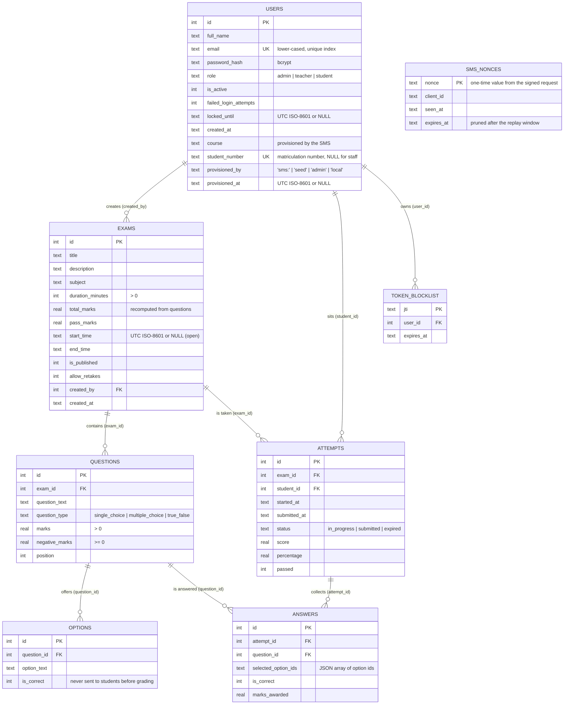

# Auspify TMS — Online Examination System

A secure online examination system. Administrators and teachers create exams
made of questions and options, students take them against a server-enforced
timer, grading happens on the server inside a transaction, and teachers get
performance reports with CSV export.

Students do **not** create their own accounts: they are provisioned by the
university's student management system over a signed server-to-server API, and
sign in with the email and password the SMS issues.

**Stack:** Python 3.11 · Flask 3 · SQLite · React 19 (Vite) · plain CSS · Recharts
**Status:** all five build steps complete and verified (see [Verification](#9-verification)).

---

## Table of contents

1. [Features](#1-features)
2. [Repository layout](#2-repository-layout)
3. [Quick start](#3-quick-start)
4. [Environment variables](#4-environment-variables)
5. [Data model (ER diagram)](#5-data-model-er-diagram)
6. [Grading rules](#6-grading-rules)
7. [API reference with roles](#7-api-reference-with-roles)
8. [Security](#8-security)
9. [Verification](#9-verification)
10. [Troubleshooting](#10-troubleshooting)
11. [UI design system and UX review](#11-ui-design-system-and-ux-review)
12. [Suggested improvements](#12-suggested-improvements)

---

## 1. Features

**Accounts and sessions**

- Roles: `admin`, `teacher`, `student`. Self-registration is disabled
  (`POST /api/auth/register` answers 403): student accounts are provisioned by
  the student management system, and teacher/admin accounts are created only by
  an admin (`POST /api/auth/users`).
- Passwords hashed with bcrypt (cost factor 12); policy: ≥ 8 characters with at
  least one letter and one digit.
- Short-lived JWT access tokens (30 min, configurable). Logout revokes the token
  through a `jti` blocklist, so a stolen-but-logged-out token cannot be replayed.
- Account lockout: 5 failed logins → 15 minutes. Per-IP rate limiting on the
  login route (10/min by default). Identical error messages for unknown emails,
  wrong passwords and disabled accounts.

**Student provisioning (SMS integration)**

- The student management system pushes each student's record — full name,
  email, course, matriculation number and password — to
  `POST /api/integration/students`. Re-sending a record updates it, so the call
  is safe to retry; a new password rotates the credential and clears any lockout.
- Every request is **HMAC-SHA256 signed** over the method, path, timestamp,
  nonce and a SHA-256 body digest, with a shared secret that never travels in
  the request. Timestamps outside a ±5-minute window are refused and every nonce
  is stored once, so a captured request cannot be replayed and a modified body
  cannot pass.
- **Both directions are verified.** Before the SMS releases any student data it
  sends a challenge to `POST /api/integration/handshake`, and the TMS signs it;
  every TMS reply carries `X-TMS-Signature` over the request nonce, so the SMS
  can prove it is talking to the real TMS and not to an impostor.
- The API can never escalate privileges: `role` is not part of the accepted
  schema, staff accounts cannot be converted, passwords are bcrypt-hashed on
  arrival, and the plain text value is never logged or returned.
- `PUT`-style status calls deactivate a withdrawn student (login then fails) and
  reactivate them; `students/lookup` answers "does this student exist?" without
  disclosing staff accounts.

**Exams (teacher / admin)**

- Full CRUD for exams, questions and options, restricted to the exam's owner
  (admins see everything).
- Validation: 2–6 options per question, at least one correct (exactly one for
  single-choice and true/false), `marks > 0`, `0 ≤ negative_marks ≤ marks`,
  `duration_minutes > 0`, `end_time > start_time`.
- An exam that is published *and* has attempts is frozen: its questions and
  options can no longer change, so grades stay explainable.

**Taking an exam (student)**

- Visible exams only: published, inside their window, not yet attempted (or
  retakes allowed).
- Countdown supplied by the server (`remaining_seconds`), rendered from an
  absolute deadline and re-synced from the server whenever the tab regains
  focus; every write is re-checked server-side, so editing the browser clock or
  sleeping the laptop cannot extend the exam.
- Answers autosave on every click; reloading or closing the tab mid-attempt
  warns first (in-app navigation is allowed, since every answer is already
  saved), and the attempt auto-submits (graded as `expired`) when time runs out.
- The answer key never leaves the server until the exam window closes.

**Grading and results**

- Server-side, in one transaction, idempotent (safe to re-run).
- Multiple-choice is all-or-nothing; unanswered questions score 0 and are never
  penalised; wrong answers deduct the question's negative marks; totals are
  floored at 0. `percentage = score / total_marks × 100`; pass when
  `score ≥ pass_marks`.
- Per-question review (what you picked vs. the correct option) is withheld until
  the exam window closes.

**Dashboards**

- Role-aware home pages with live counters: students see open / in-progress /
  completed exams; staff see exams, published, drafts and total attempts. A
  failed load degrades to an inline message instead of an error screen.

**Interface**

- One minimal design system: 25 role-based colour tokens, an 8-step type scale,
  6 spacing steps, 2 radii and a single shadow (overlays only). Cards and tables
  are separated by hairlines instead of shadows, and one accent colour marks the
  primary action, active navigation and selection.
- Every interactive border meets the 3 : 1 non-text contrast rule and every text
  pair meets WCAG AA; pass/fail never relies on colour alone.
- Keyboard first: a single `:focus-visible` ring, 40 px targets (44 px on touch
  and for answer options), a trapped focus dialog that returns focus to its
  opener, `aria-live` on the exam countdown and a `prefers-reduced-motion`
  fallback.
- Each page has loading, empty, error and forbidden states.
- Verified by `axe-core` on all 11 screens, a static UX audit
  (`scripts/ux_check.py`) and the live walk in `ui_smoke.py` — see
  [frontend/UX_REVIEW.md](frontend/UX_REVIEW.md).

**Reports**

- Exam report: average / highest / lowest / median percentage, pass rate, score
  distribution across five bands, per-question difficulty.
- Student report: attempt history plus a percentage trend.
- Leaderboard per exam.
- Every report exports to CSV (formula-injection hardened).
- React dashboards (Recharts) for exam reports, student reports and a student's
  own progress page.

---

## 2. Repository layout

```
.
├── backend/
│   ├── app/
│   │   ├── __init__.py            # app factory: guards, converters, CORS,
│   │   │                          # security headers, JSON error handlers
│   │   ├── config.py              # configuration from env vars; fails fast
│   │   ├── db.py                  # SQLite access: PRAGMA foreign_keys=ON,
│   │   │                          # WAL, one connection per request, transactions
│   │   ├── schema.sql             # tables + indexes (idempotent, CREATE IF NOT EXISTS)
│   │   ├── security.py            # bcrypt, JWT, @role_required, current_user()
│   │   ├── sms.py                 # HMAC request/response signing for the SMS API
│   │   ├── schemas.py             # marshmallow request schemas (all validation)
│   │   ├── services.py            # data-access helpers shared by the routes
│   │   ├── grading.py             # scoring rules (single source of truth)
│   │   ├── reports.py             # aggregations, CSV rendering, CSV hardening
│   │   ├── extensions.py          # Flask-Limiter instance
│   │   └── routes/
│   │       ├── health.py          # GET /api/health
│   │       ├── auth.py            # login, logout, me, admin user creation
│   │       ├── integration.py     # SMS provisioning (handshake, students, status)
│   │       ├── exams.py           # exam/question CRUD + student exam endpoints
│   │       ├── attempts.py        # start, answer, submit, get attempt, result
│   │       └── reports.py         # exam / student / leaderboard reports (+ CSV)
│   ├── tests/                     # Step 5 security suite (149 tests)
│   │   ├── conftest.py            # temp DB per test, secrets, client + role fixtures
│   │   ├── helpers.py             # account seeding, exam/question/attempt builders
│   │   ├── test_auth_security.py  # brute force, tokens, policy, enumeration
│   │   ├── test_authorization.py  # vertical + horizontal access control
│   │   ├── test_injection.py      # SQL injection, XSS, error-page format
│   │   ├── test_exam_integrity.py # answer leakage, timer, replay, double submit
│   │   ├── test_validation.py     # malformed input -> clean 4xx, never 500
│   │   ├── test_config_and_headers.py  # secrets, CORS, headers, debug, guards
│   │   ├── test_sms_integration.py     # signing, replay, skew, provisioning rules
│   │   └── pytest_report.txt      # saved output of the last full run
│   ├── instance/                  # SQLite database (git-ignored)
│   ├── pytest.ini                 # testpaths = tests
│   ├── SECURITY_REPORT.md         # Step 5 report: controls, findings, fixes
│   ├── README_steps.md            # build log, step by step
│   ├── requirements.txt           # pinned backend + test dependencies
│   ├── run.py                     # dev entry point (banner hidden)
│   └── seed.py                    # seeds 1 admin, 1 teacher, 3 students
├── frontend/
│   ├── src/
│   │   ├── api/client.js          # single fetch wrapper: authApi, examsApi,
│   │   │                          # attemptsApi, resultsApi, reportsApi, downloadCsv
│   │   ├── auth/                  # AuthContext + ProtectedRoute/RequireRole
│   │   ├── components/            # ui.jsx (Button/Card/Field/Alert), AppLayout, Modal
│   │   ├── pages/
│   │   │   ├── LoginPage.jsx, RegisterPage.jsx, Dashboards.jsx
│   │   │   ├── teacher/
│   │   │   │   ├── TeacherExamsPage.jsx   # list + publish + report links
│   │   │   │   ├── ExamEditorPage.jsx     # exam + question/option builder
│   │   │   │   ├── ExamReportPage.jsx     # charts, difficulty, leaderboard, CSV
│   │   │   │   └── StudentReportPage.jsx  # one student's history + trend
│   │   │   └── student/
│   │   │       ├── StudentExamsPage.jsx   # available exams, start/continue
│   │   │       ├── TakeExamPage.jsx       # countdown, autosave, submit confirm
│   │   │       ├── ResultPage.jsx         # score + review when released
│   │   │       └── ProgressPage.jsx       # own history + trend chart
│   │   ├── test/                  # vitest + testing-library + axe (46 tests, 8 files)
│   │   ├── App.jsx                # routes with role guards
│   │   └── index.css              # the whole design system (tokens + components)
│   ├── UX_REVIEW.md               # UX findings, severity, fixes, remaining work
│   ├── vite.config.js             # dev/preview servers + /api proxy, outDir
│   └── package.json
├── scripts/
│   ├── verify_step0.sh            # 30 checks — setup, headers, CORS, proxy, build
│   ├── verify_step1.py            # 54 checks — authentication + RBAC
│   ├── verify_step2.py            # 79 checks — exams, questions, attempts, timer
│   ├── verify_step3.py            # 44 checks — grading + result access
│   ├── verify_step4.py            # 68 checks — reports + CSV hardening
│   ├── verify_step5.py            # 56 checks — live security attacks
│   ├── sms_client.py              # reference SMS client: signing + handshake + provisioning
│   ├── ui_smoke.py                # 67 checks — every page, over the UI origin
│   ├── ux_check.py                # 56 checks — design tokens, contrast, a11y, UX states
│   └── e2e_check.py               # 43 checks — full walkthrough over real HTTP
├── COMPLETION_AUDIT.md            # README-vs-code audit: every claim re-verified
├── LICENSE
├── .gitignore                     # .env, instance/, node_modules, dist, …
└── README.md
```

---

## 3. Quick start

Two terminals. The backend serves `http://localhost:5000`, the UI runs on
`http://localhost:5173` and proxies `/api` to Flask.

```bash
# --- terminal 1: backend ---------------------------------------------------
cd backend
python3 -m venv .venv
.venv/bin/pip install -r requirements.txt
cp .env.example .env                     # then fill in the two keys (see §4)
.venv/bin/python seed.py                 # creates the DB + sample accounts
.venv/bin/python run.py                  # http://localhost:5000

# --- terminal 2: frontend --------------------------------------------------
cd frontend
npm install
npm run dev                              # http://localhost:5173
```

There is no "create account" screen. To add a student by hand, run the
reference SMS client (it signs the request exactly like a real student
management system):

```bash
backend/.venv/bin/python scripts/sms_client.py handshake     # verify the TMS
backend/.venv/bin/python scripts/sms_client.py provision \
  --name "Efua Mensah" --email efua@uni.edu.gh \
  --course "BSc Statistics" --number ST/2024/0100 --password 'St@ts2024x'
```

Seeded development accounts (credentials come from `.env`, see `SEED_*`):

| Role | Email (default) | Password |
| --- | --- | --- |
| admin | `admin@auspify.test` | `SEED_ADMIN_PASSWORD` |
| teacher | `teacher@auspify.test` | `SEED_TEACHER_PASSWORD` |
| student ×3 | `student1@auspify.test` … | `SEED_STUDENT_PASSWORD` |

Health check: `curl -s http://localhost:5000/api/health`

---

## 4. Environment variables

`backend/.env` is git-ignored; only `backend/.env.example` is committed. The app
**refuses to start** if `SECRET_KEY` or `JWT_SECRET_KEY` is missing.

```bash
cp backend/.env.example backend/.env
python -c "import secrets; print('SECRET_KEY=' + secrets.token_hex(32))"
python -c "import secrets; print('JWT_SECRET_KEY=' + secrets.token_hex(32))"
```

| Variable | Required | Default | Purpose |
| --- | --- | --- | --- |
| `SECRET_KEY` | yes | — | Flask signing key |
| `JWT_SECRET_KEY` | yes | — | JWT signing key (separate, independently rotatable) |
| `JWT_ALGORITHM` | no | `HS256` | JWT algorithm |
| `JWT_ACCESS_TOKEN_EXPIRES_MINUTES` | no | `30` | Access-token lifetime |
| `APP_ENV` | no | `development` | `production` enables the startup guards |
| `APP_DEBUG` | no | `0` | Must stay `0`; `production` + `1` refuses to start |
| `DATABASE_PATH` | no | `backend/instance/exam_system.db` | SQLite file |
| `CORS_ORIGINS` | no | `http://localhost:5173,http://127.0.0.1:5173` | Browser origins allowed to call the API |
| `ALLOW_PREVIEW_EMBEDDING` | no | `1` outside production | Lets a hosted preview frame the `/` status page (API is never frameable) |
| `PORT` | no | `5000` | API port |
| `MAX_FAILED_LOGINS` | no | `5` | Failures before lockout |
| `LOCKOUT_MINUTES` | no | `15` | Lockout duration |
| `LOGIN_RATE_LIMIT` | no | `10 per minute` | Flask-Limiter limit for `/api/auth/login` |
| `REGISTER_RATE_LIMIT` | no | `20 per minute` | Flask-Limiter limit for the disabled registration stub |
| `SMS_CLIENT_ID` | no | `sms-gateway` | Identifier the SMS signs with |
| `SMS_CLIENT_SECRET` | to enable | — | Shared HMAC secret; **empty switches the integration off (503)** |
| `SMS_MAX_SKEW_SECONDS` | no | `300` | Accepted clock difference / replay window |
| `SMS_ALLOWED_IPS` | no | — | Optional comma-separated source allow-list |
| `SMS_RATE_LIMIT` | no | `120 per minute` | Flask-Limiter limit for `/api/integration/*` |
| `RATELIMIT_STORAGE_URI` | no | `memory://` | Use Redis in production |
| `RATELIMIT_ENABLED` | no | `1` | `0` disables the limiter (used by the pytest suite) |
| `SEED_ADMIN_EMAIL` / `SEED_ADMIN_PASSWORD` | no | — | Used by `seed.py` |
| `SEED_TEACHER_EMAIL` / `SEED_TEACHER_PASSWORD` | no | — | Used by `seed.py` |
| `SEED_STUDENT1..3_EMAIL`, `SEED_STUDENT_PASSWORD` | no | — | Used by `seed.py` |

Frontend (`frontend/.env`, optional): `VITE_API_BASE_URL` — leave empty to use
the Vite proxy (recommended in development).

---

## 5. Data model (ER diagram)



Conventions: timestamps are UTC ISO-8601 strings, booleans are `INTEGER 0/1`,
every foreign key is declared and enforced with `PRAGMA foreign_keys = ON`.
Indexes: unique `users(email)`, unique `users(student_number)` (partial, only
when not NULL), `users(role)`, `exams(created_by)`,
`exams(is_published)`, `questions(exam_id)`, `options(question_id)`,
`attempts(exam_id)`, `attempts(student_id)`, `attempts(exam_id, student_id)`,
`answers(attempt_id)`, `answers(question_id)`, `token_blocklist(expires_at)`,
`sms_nonces(expires_at)`.

---

## 6. Grading rules

Implemented once in `backend/app/grading.py` and used both on submit and on
auto-expiry:

| Question type | Scoring |
| --- | --- |
| `single_choice`, `true_false` | exact match with the correct option → full `marks`, otherwise `-negative_marks` |
| `multiple_choice` | the selected set must equal the correct set exactly (all-or-nothing) → full `marks`, otherwise `-negative_marks` |
| unanswered | `0` — never penalised |

`score = max(0, sum(marks_awarded))`; `percentage = score / total_marks × 100`
(0 when the exam has no marks); `passed = score >= pass_marks`. Grading runs in
one transaction and uses absolute `UPDATE`s plus
`INSERT … ON CONFLICT DO UPDATE`, so repeating it cannot double-count.

---

## 7. API reference with roles

Base URL `/api`. Authentication: `Authorization: Bearer <access_token>`.
Errors are always `{"error": {"code": <int>, "message": <str>, "fields"?: {...}}}`.
Roles: **A** = admin, **T** = teacher (own exams only), **S** = student, **—** = anonymous, **Owner** = the user who owns the record.

### Health

| Method | Path | Roles | Notes |
| --- | --- | --- | --- |
| GET | `/health` | — | liveness/readiness, no configuration leaked |

### Authentication

| Method | Path | Roles | Notes |
| --- | --- | --- | --- |
| POST | `/auth/register` | — | **disabled** — always 403; students are provisioned by the SMS |
| POST | `/auth/login` | — | rate limited; lockout after 5 failures; returns `access_token` + user |
| POST | `/auth/logout` | any | revokes the presented token (`jti` blocklist) |
| GET | `/auth/me` | any | current profile (role re-read from the database) |
| POST | `/auth/users` | A | creates a teacher/admin/student account |

### Exams (authoring)

| Method | Path | Roles | Notes |
| --- | --- | --- | --- |
| GET | `/exams` | any | students see only exams they may take; staff see their own (admins: all) |
| POST | `/exams` | T, A | `title`, `duration_minutes` required |
| GET | `/exams/<id>` | any | students: sanitized (no answer key) |
| PUT | `/exams/<id>` | Owner, A | 403 for other teachers, 409 when published with attempts |
| DELETE | `/exams/<id>` | Owner, A | cascades questions/options/attempts; 409 when attempts exist |
| GET | `/exams/<id>/questions` | Owner, A | full question feed including `is_correct` |
| POST | `/exams/<id>/questions` | Owner, A | 2–6 options, ≥1 correct (exactly 1 for single/true-false) |
| PUT | `/questions/<id>` | Owner, A | same validation |
| DELETE | `/questions/<id>` | Owner, A | |

### Taking an exam

| Method | Path | Roles | Notes |
| --- | --- | --- | --- |
| POST | `/exams/<id>/start` | S | idempotent while in progress; 409 for a second attempt unless retakes; 403 outside the window |
| GET | `/attempts/<id>` | Owner | progress + `remaining_seconds`; auto-submits when expired |
| PUT | `/attempts/<id>/answer` | Owner | autosave one answer; 409 after the deadline; option ids must belong to the question |
| POST | `/attempts/<id>/submit` | Owner | grades in one transaction; repeat submits are idempotent |

### Results

| Method | Path | Roles | Notes |
| --- | --- | --- | --- |
| GET | `/attempts/<id>/result` | Owner, Owner-of-exam (T/A) | 404 for non-owners, 409 while in progress; `review_available` gates the answer key until the exam window closes |

### Student provisioning (student management system only)

These endpoints are **not** part of the browser API: no JWT, cookie or session
can call them. Every request and every response is signed — the scheme is
specified below and implemented in `backend/app/sms.py`.

| Method | Path | Auth | Notes |
| --- | --- | --- | --- |
| POST | `/integration/handshake` | HMAC | signs the caller's `challenge` so the SMS can verify the TMS before releasing data |
| POST | `/integration/students` | HMAC | create or update one student (`full_name`, `email`, `password`, `course`, `student_number`, `is_active`); 201 created, 200 updated |
| POST | `/integration/students/status` | HMAC | activate / deactivate a provisioned student |
| POST | `/integration/students/lookup` | HMAC | `{exists, student}`; never discloses staff accounts |

All four are `POST` so the body is always covered by the signature.

Request headers: `X-SMS-Client`, `X-SMS-Timestamp` (unix seconds),
`X-SMS-Nonce` and `X-SMS-Signature: v1=<hex>`, where

```
canonical = "v1" \n METHOD \n PATH \n TIMESTAMP \n NONCE \n SHA256(body)
signature = HMAC-SHA256(secret, canonical)
```

Replies carry `X-TMS-Timestamp` and `X-TMS-Signature` over
`"v1-response" \n METHOD \n PATH \n STATUS \n TIMESTAMP \n REQUEST-NONCE \n SHA256(body)`.
The handshake signature is
`HMAC-SHA256(secret, "v1-handshake" \n CLIENT_ID \n CHALLENGE \n SERVER_TIME)`.

`scripts/sms_client.py` is a working reference implementation (library + CLI)
of the SMS side.

### Reports

| Method | Path | Roles | Notes |
| --- | --- | --- | --- |
| GET | `/reports/exam/<id>` | Owner, A | summary, distribution, per-question difficulty; `?format=csv` |
| GET | `/reports/student/<id>` | Owner (self), A, T (their exams) | history + trend; `?format=csv` |
| GET | `/reports/leaderboard/<id>` | Owner, A, S (after sitting it, window closed) | ranked attempts; `?format=csv` |

Students never receive the exam-wide report (it would expose other students'
results and, through difficulty statistics, the answer key).

---

## 8. Security

Full detail, findings and fixes: **[`backend/SECURITY_REPORT.md`](backend/SECURITY_REPORT.md)**.

- **Secrets** live only in `backend/.env` (git-ignored); no key is hardcoded and
  the app refuses to boot without one. `requirements.txt` and `.env.example` are
  free of real values.
- **Passwords** are bcrypt hashes; login errors are identical for unknown
  emails, wrong passwords and disabled accounts.
- **Tokens** are short-lived (30 min), signed with a dedicated key, and revoked
  on logout via a `jti` blocklist. The role is always re-read from the database,
  so a forged `role` claim achieves nothing.
- **Authorization** is enforced server-side: `@role_required` for vertical
  access, per-record ownership checks for horizontal access. Students never see
  the answer key before the window closes.
- **SQL** is parameterised everywhere; there is no string-built SQL in the
  codebase. SQLite runs with `PRAGMA foreign_keys = ON`.
- **Input validation** happens in marshmallow schemas plus defensive route
  checks; malformed input produces a clean 4xx with field details, never a 500.
  Bodies larger than 2 MB are rejected with 413.
- **Integration API**: student provisioning is authenticated with HMAC-SHA256
  over a SHA-256 body digest, a timestamp inside a ±5-minute window and a
  one-time nonce stored in `sms_nonces` (so captured requests cannot be
  replayed, and a single changed byte invalidates the signature). Comparisons
  are constant-time, the secret has no default and the endpoints answer 503
  while it is empty, an optional IP allow-list can pin the caller, and the API
  refuses to touch staff accounts or accept a `role` field. Replies are signed
  too, so both sides verify each other; passwords are bcrypt-hashed on arrival
  and never logged.
- **Browser protections**: CORS allow-list (never `*`), `X-Content-Type-Options:
  nosniff`, `X-Frame-Options: DENY`, `Content-Security-Policy: default-src
  'none'` and `Cache-Control: no-store` on `/api/*`, `Referrer-Policy:
  no-referrer`. The React client never uses `dangerouslySetInnerHTML`, so user
  text is escaped by construction.
- **Operational hardening**: debug off (`APP_ENV=production` refuses to start
  with debug or testing enabled), the framework banner is hidden
  (`Server: auspify-tms`), oversized integer ids are rejected before they reach
  SQLite, and CSV exports neutralise spreadsheet formula injection
  (`= + - @` are prefixed with `'`).
- **Known/accepted risks** (documented in the report): tokens live in
  `localStorage` (no httpOnly cookies yet), account lockout is observable, and
  development runs over plain HTTP.

---

## 9. Verification

Everything below was executed; the numbers are the actual results. Every claim
in this README was re-checked against the code on 2026‑11‑07 — see
[COMPLETION_AUDIT.md](COMPLETION_AUDIT.md).

| Step | Command | Expected |
| --- | --- | --- |
| 0 | `./scripts/verify_step0.sh` | `RESULT: 30 passed, 0 failed` |
| 1 | `backend/.venv/bin/python scripts/verify_step1.py` | `68 passed, 0 failed` |
| 2 | `backend/.venv/bin/python scripts/verify_step2.py` | `79 passed, 0 failed` |
| 3 | `backend/.venv/bin/python scripts/verify_step3.py` | `44 passed, 0 failed` |
| 4 | `backend/.venv/bin/python scripts/verify_step4.py` | `68 passed, 0 failed` |
| 5 | `cd backend && .venv/bin/python -m pytest` | `194 passed` |
| 5 | `cd backend && .venv/bin/python ../scripts/verify_step5.py` | `56 passed, 0 failed` |
| e2e | `cd backend && .venv/bin/python ../scripts/e2e_check.py` | `50 passed, 0 failed` |
| site | `cd backend && .venv/bin/python ../scripts/ui_smoke.py` | `67 passed, 0 failed` |
| site (build) | `SITE_BASE=http://127.0.0.1:4173 .venv/bin/python ../scripts/ui_smoke.py` | `67 passed, 0 failed` |
| UI | `cd frontend && npx vitest run` | `45 passed (8 files)` |
| UI a11y | `cd frontend && npx vitest run src/test/a11y.test.jsx` | `12 passed`, 0 axe violations on 11 screens |
| UX | `cd frontend && python3 ../scripts/ux_check.py` | `56 passed, 0 failed` |
| UI | `cd frontend && npx oxlint src && npm run build` | no findings, build OK |
| deps | `cd frontend && npm audit` | `0 vulnerabilities` |

`verify_step0.sh`, `e2e_check.py` and `ui_smoke.py` need the running servers
(backend on 5000, frontend on 5173). The pytest suite and the other
`verify_stepN.py` scripts create their own data and only need the venv.

**`ui_smoke.py` is the browser stand-in:** it walks every page over the same
origin the browser uses (the Vite dev server, or a production preview via
`SITE_BASE=http://127.0.0.1:4173`),
asserts the app shell, static assets, deep-link fallbacks and the exact JSON
fields each React page renders, then drives the whole journey — register →
teacher creates/publishes an exam → student starts/answers/submits → result →
progress → teacher report/leaderboard/CSV — and finally unpublishes its own
smoke exam. It is idempotent and safe to re-run.

Checking the **production build** end to end:

```bash
cd frontend
npm run preview:build        # vite build --outDir preview-dist
npm run preview:serve        # http://localhost:4173
```

`vite.config.js` gives the preview server the same `/api` proxy as the dev
server, so the built bundle can be exercised (SPA deep links included) without a
reverse proxy. The build output directory is configurable (`VITE_OUT_DIR`, or
`--outDir`): `preview-dist` is used for hosted previews because sandboxes wipe
folders named `dist`/`build`/`out` between snapshots, which would leave the
preview serving a missing document root (all 404s).

---

## 10. Troubleshooting

| Symptom | Cause / fix |
| --- | --- |
| `RuntimeError: SECRET_KEY ...` at startup | `backend/.env` missing or empty — copy `.env.example` and add real keys |
| `429 Too many requests` while testing by hand | Login is rate limited (10/min per IP) — wait a minute; the lockout lasts 15 min per account |
| `401 Authentication required` right after login | Token expired (30 min) or was revoked by logout — log in again |
| Frontend shows "API unreachable" | Flask is not running on port 5000, or `CORS_ORIGINS` lacks the origin you are browsing from |
| Empty charts / blank report page | The exam has no submitted attempts yet; reports only count `submitted`/`expired` attempts |
| `PRAGMA foreign_keys` warnings on delete | Delete through the API (cascades are declared), not manually in SQL |
| pytest is slow (~6 min) | Intentional: bcrypt hashing of seeded accounts dominates. Use `pytest tests/test_validation.py` while iterating |
| `npm run preview` shows a blank page or every route 404s | The output folder is missing (sandboxes wipe `dist/`). Rebuild with `npm run preview:build` and serve with `npm run preview:serve`; make sure the API is running, the preview proxies `/api` to port 5000 |
| `/api/health` reports an old `version` | Flask runs with `use_reloader=False`: restart it after backend edits (`kill` + `python run.py`) |
| `ui_smoke.py` reports `login rate limited, waiting 62s` | Expected if it runs right after other login-heavy scripts: the login limiter allows 10 requests a minute per IP and the script waits it out |

---

## 11. UI design system and UX review

`frontend/src/index.css` is the entire design system — no CSS framework, no
per-page overrides. Everything derives from one `:root` block:

| Group | Tokens |
| --- | --- |
| Surface and text | `--bg`, `--surface`, `--surface-muted`, `--row-hover`, `--border`, `--border-strong`, `--border-subtle`, `--text`, `--muted` |
| Accent | `--accent`, `--accent-hover`, `--accent-soft`, `--accent-border`, `--on-accent` |
| Status | `--success`, `--success-soft`, `--success-border`, `--success-on-soft`, `--danger`, `--danger-strong`, `--danger-soft`, `--danger-border`, `--danger-on-soft` |
| Type | `--text-xs` … `--text-display` (8 steps) |
| Space, shape, depth | `--space-1` … `--space-6`, `--radius`, `--radius-sm`, `--shadow-overlay` (the only shadow) |

Colour decisions are measured, not eyeballed: body text 16.1 : 1, secondary
text 7.6 : 1, accent 6.7 : 1, error text 6.6 : 1, success text 5.0 : 1, control
borders 3.27 : 1 — all above the WCAG 2.1 AA thresholds. `ux_check.py`
recomputes these from the token values, so the palette cannot silently regress.

**The UX review** ([frontend/UX_REVIEW.md](frontend/UX_REVIEW.md)) records what
was audited, the seven findings and fixes (focus trap, control-border contrast,
three high-severity router advisories, palette drift, type/spacing sprawl, dead
CSS, hardcoded colours), and the remaining recommendations — skip link,
`aria-busy` regions, dark mode, table virtualisation.

Re-running the whole UI verification takes about a minute:

```bash
cd frontend
npx vitest run src/test/a11y.test.jsx    # axe-core, 11 screens
npx vitest run                           # 45 UI tests
python3 ../scripts/ux_check.py           # 56 static UX checks
npm audit
```

---

## 12. Suggested improvements

Interface work is listed in
[frontend/UX_REVIEW.md §6](frontend/UX_REVIEW.md) (skip link, `aria-busy`
regions, dark mode, table virtualisation); the items below are backend and
product work.

**Security**

- httpOnly + `Secure` + `SameSite` cookies with double-submit CSRF tokens
  (removes the XSS → token-theft path entirely).
- HTTPS/HSTS in production; `Secure` cookies once cookies exist.
- Refresh tokens with rotation and reuse detection.
- Email verification and password reset (single-use, expiring tokens).
- TOTP 2FA for admin and teacher accounts.
- Per-email failure counters that also apply to unknown addresses (closes the
  documented lockout-enumeration signal).
- Audit log of privileged actions plus alerting on repeated 401/403.
- `pip-audit` / `npm audit` and Dependabot in CI.

**Exam integrity**

- Randomise question and option order per attempt.
- One question per page with server-side navigation logging.
- Tab/blur detection and heartbeat checks while an attempt is in progress.
- Essay/free-text questions with a manual grading workflow and rubric.
- Plagiarism/collusion heuristics for multiple-choice patterns.

**Platform**

- Postgres + migrations (Alembic) instead of SQLite for concurrent load.
- Docker Compose (API + UI + Postgres + Redis) for reproducible deployment.
- Redis for rate-limit and blocklist storage so limits survive restarts.
- Pagination and filtering for long exam/attempt lists.
- i18n, accessibility audit (WCAG), and a dark theme.
- CI pipeline: pytest, vitest, oxlint, build, and the `verify_step*.py` scripts.
